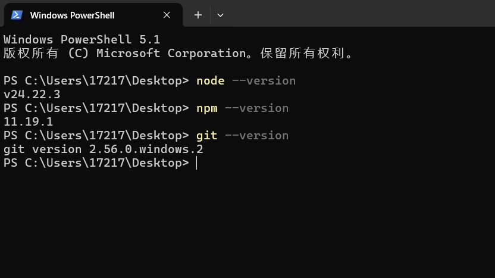
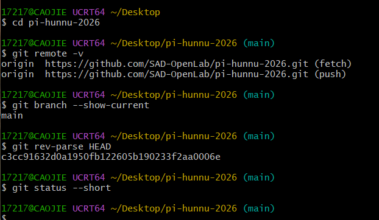
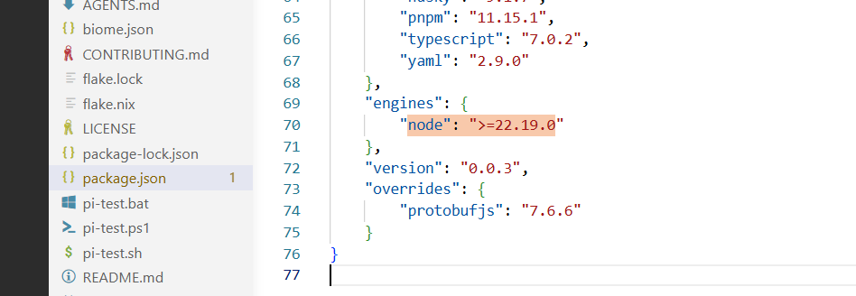
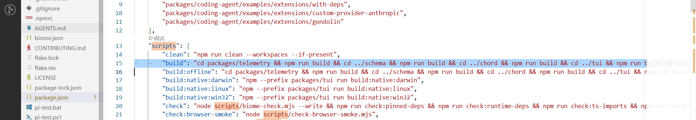
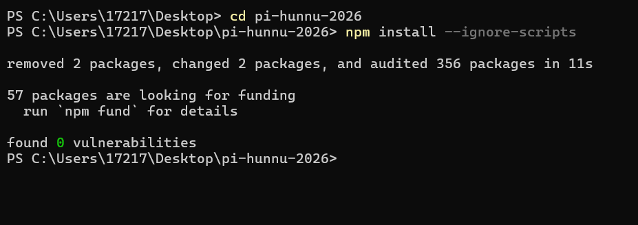
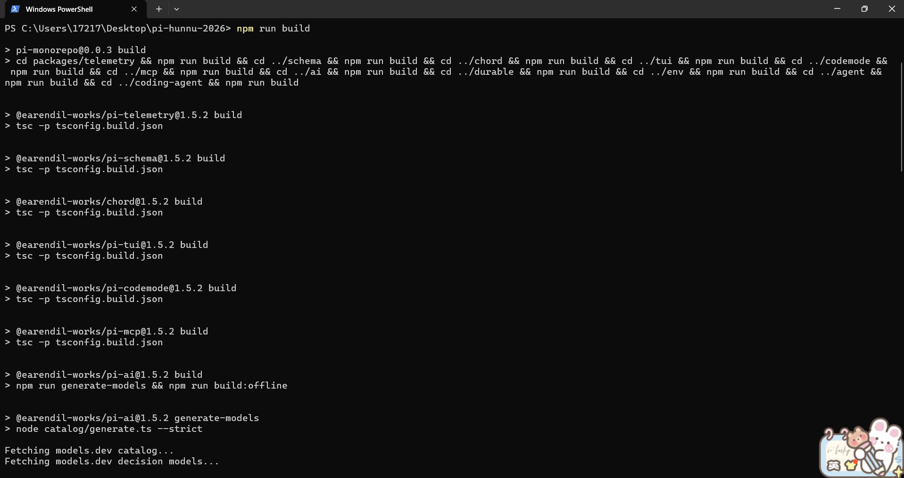
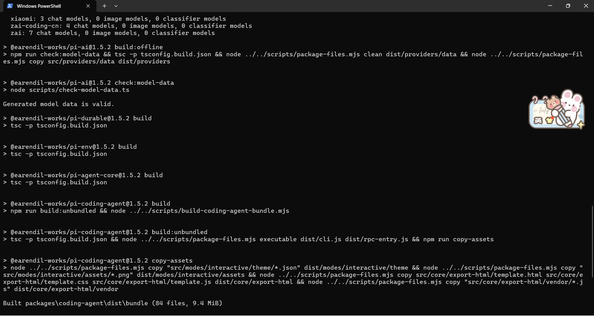
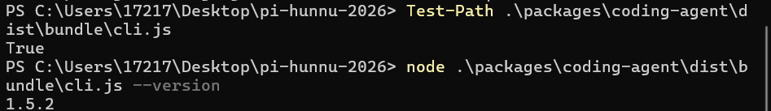
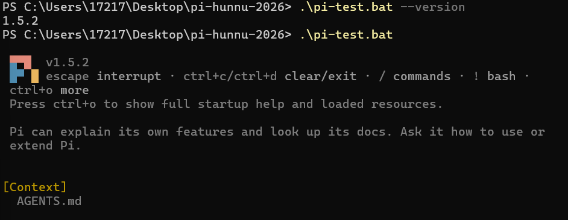
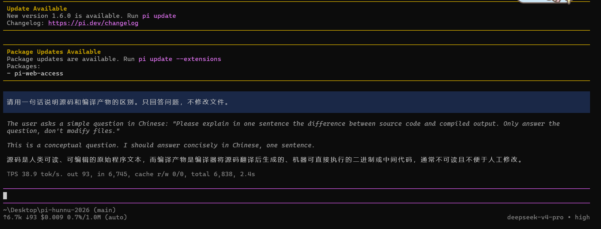

# 实践课3：Pi Agent 源码获取、依赖安装与本地编译实验报告

## 一、 实验环境与准备（任务一）

**1. 环境检查**
在 PowerShell 中执行环境检查命令，结果如下：
*   Node.js 版本：v24.22.3
*   npm 版本：11.19.1
*   Git 版本：2.56.0.windows.2

*图 S1：显示当前环境依赖的各个版本*

**2. 遇到的困难及解决过程**
*   **困难一：旧版 Node.js 环境冲突。**
    *   **描述**：最初检查环境时，发现 Node.js 默认指向了 `C:\Users\17217\AppData\Local\pi-node\current`（旧版本 v22.23.4），这会导致后续安装依赖时出现 `EBADENGINE` 警告。
    *   **解决**：通过“编辑系统环境变量”，在用户变量的 `Path` 列表中删除了旧的 `pi-node` 路径，并下载 Node.js 24 LTS 官方安装包进行了覆盖安装。
*   **困难二：PowerShell 禁止运行 npm 脚本。**
    *   **描述**：重新配置环境后，执行 `npm -v` 报错 `UnauthorizedAccess`，提示无法加载 `npm.ps1`，这是由于 Windows 默认执行策略导致的安全拦截。
    *   **解决**：在 PowerShell 中执行 `Set-ExecutionPolicy -ExecutionPolicy RemoteSigned -Scope CurrentUser`，放行本地脚本执行权限，成功输出版本号。

---

## 二、 下载课程仓库源码（任务二）

**1. 源码下载与确认**
将小组仓库克隆到本地 `pi-hunnu-2026` 目录，并切换到 `main` 分支。

*图 S2：显示当前目录、远端地址、分支和提交编号*

---

## 三、 阅读配置，确认安装与编译依据（任务三）

**1. 配置文件观察**
在仓库根目录的 `package.json` 中查找关键配置：
*   **Node.js 版本要求在哪里？**
    答：定义在 `package.json` 文件的 `engines` 字段中，当前要求为 `">=22.19.0"`。
*   **`npm run build` 实际从哪里读取命令？**
    答：实际是从根目录 `package.json` 文件的 `scripts` 对象中读取 `"build"` 对应的具体命令。该命令会依次进入 `packages/` 目录下的各个子包并执行构建。

*图 S3-1：engines.node 的定义*

*图 S3-2：scripts.build 的定义*

---

## 四、 安装项目依赖（任务四）

**1. 执行安装**
在仓库根目录执行 `npm install --ignore-scripts`，跳过自动生命周期脚本，成功安装项目所需依赖库和开发工具。

*图 S4：安装结束的输出结果（无红色报错，依赖安装成功）*

---

## 五、 本地编译与构建产物验证（任务五）

**1. 首次构建**
在仓库根目录执行 `npm run build`，终端依次进入各个子包（telemetry、schema 等）进行编译。最后输出了 `Built packages\coding-agent\dist\bundle (84 files, 9.4 MiB)`，构建成功。

*图 S5-1：构建启动与各子包编译过程*

*图 S5-2：构建完成的最后输出*

**2. 检查并运行构建产物**
执行命令验证产物是否存在并尝试运行：
*   `Test-Path .\packages\coding-agent\dist\bundle\cli.js` 输出 `True`（文件存在）。
*   `node .\packages\coding-agent\dist\bundle\cli.js --version` 输出 `1.5.2`（产物可正常运行）。

*图 S5-3：验证产物存在并成功输出版本号*

---

## 六、 启动本地源码版本并完成一次会话（任务六）

**1. 启动本地源码**
执行 `.\pi-test.bat` 启动，在安全提示中选择信任该文件夹，进入交互界面。输入提示词：“请用一句话说明源码和编译产物的区别。只回答问题，不修改文件。”
AI 成功给出了准确的回答。

*图 S6-1：验证本地入口并启动交互界面*

*图 S6-2：发送测试问题与 AI 的回复*

**2. 报告说明解答**
*   **本次如何确保运行的是本地源码？**
    答：因为执行的是仓库根目录下的 `.\pi-test.bat` 脚本，该脚本会调用当前 Node.js 环境运行本地的 `packages/coding-agent/src/cli.ts` 源码，而不是去调用系统全局安装的 `pi` 命令，因此确保了运行的是本地下载的源码。
*   **源码入口与 `dist/bundle/cli.js` 入口分别适合什么场景？**
    答：
    *   **源码入口（`src/cli.ts`）**：适合**开发调试**场景。修改代码后无需等待完整的编译构建即可快速运行查看效果，方便断点排查问题。
    *   **编译产物入口（`dist/bundle/cli.js`）**：适合**生产部署与交付**场景。它经过编译器优化打包，执行效率高，且不依赖开发环境（如 TypeScript 编译器），是最终面向用户的运行形态。